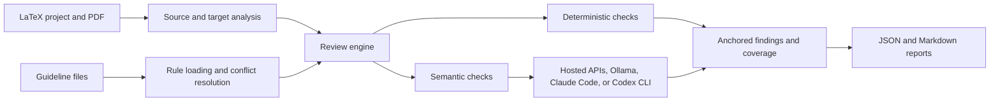

# advisor-review

`advisor-review` is a local-first CLI for reviewing LaTeX manuscripts against advisor, journal, conference, and project guidelines. It analyzes LaTeX source and the compiled PDF, then writes anchored findings as JSON and Markdown.

## Architecture



## Install from crates.io

Once released:

```bash
cargo install advisor-review
advisor-review --help
```

## Run a review

```bash
advisor-review review \
  --project ./paper \
  --guidelines ./guidelines \
  --output ./review
```

The project must contain `main.tex` and `main.pdf` by default. Results are written to:

```text
review/findings.json
review/findings.md
```

Exit code `0` means the configured review completed (findings may still exist). Exit code `1` means failure or an incomplete review; inspect the reports for invalid rules, skipped checks, or provider errors. Invalid inputs/configuration return `2`. API providers require an explicit model; Claude Code and Codex CLI can use their configured default.

For complete CLI, rule, provider, output, and troubleshooting documentation, see [CONFIGURATION.md](CONFIGURATION.md).

Use the documented VS Code task to surface source-anchored findings in the Problems panel and jump directly to the relevant LaTeX lines.

Semantic reviews support OpenAI, Anthropic, OpenRouter, Ollama, and installed Claude Code or Codex CLI clients. See [provider setup](CONFIGURATION.md#provider-and-model-configuration) for details.

The repository's [writing don'ts guide](guidelines/writing-donts.md) includes a
companion [semantic rule pack](guidelines/writing-donts.yaml) for filler, repetitive
structure, and misleading metaphors. With `--guidelines ./guidelines`, the YAML
rules activate while the Markdown checklist remains a candidate. These checks
require a configured provider and model; without one, they are skipped and the
review is incomplete. They assess writing quality, not AI authorship.

To turn Markdown guidelines into rules, run `advisor-review compile --guidelines <file.md> --provider claude-code` (or `codex-cli`). It writes a draft rule pack with example tests next to the source. Draft rules do not run until you change them to `status: active`; `advisor-review rules test` runs the examples of every rule. See [compiling guidelines](CONFIGURATION.md#compile-markdown-guidelines-into-rules).

Sentence, paragraph, section (including its body), and whole-manuscript checks run independently. Select levels with `--scopes sentence,paragraph,section,manuscript`, or omit the flag to run all configured scopes. Rules can choose surrounding context, exact section titles, and prose/source text views. JSON schema 2.0 exposes the hierarchy, precise multi-file source locations, and execution coverage; Markdown groups findings by scope and section.

Semantic prompts are bounded by `--max-input-bytes` (default 32768). Oversized section/manuscript checks use chunk review and synthesis, and are explicitly reported as partial coverage with exit code 1. See the configuration guide for rule examples and migration from heading-only section checks.

## Build from source

```bash
git clone git@github.com:imranur-rahman/advisor-review.git
cd advisor-review
cargo run -- review --project ./paper --guidelines ./guidelines --output ./review
```

Run tests with:

```bash
cargo test --locked
cargo fmt --all -- --check
```

Tests include a manuscript fixture, generated valid PDFs, and local mock HTTP providers. No live provider credentials are needed. CI runs the suite on Linux and macOS with Rust 1.85.0.

## Publishing

Release and crates.io instructions are in [PUBLISHING.md](PUBLISHING.md).
